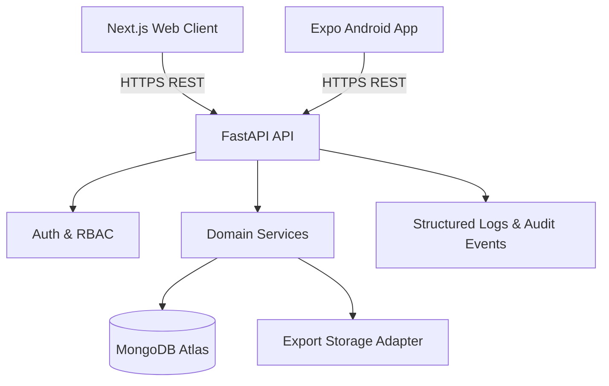

# 02 — System Architecture

## 1. Logical architecture



## 2. Monorepo layout

```text
roommate-ledger/
  apps/
    web/                    # Next.js
    mobile/                 # Expo React Native
  backend/
    app/
      api/v1/               # routers
      core/                 # config, security, errors, logging
      database/             # PyMongo client, indexes, migrations
      models/               # persistence documents
      schemas/              # request/response DTOs
      repositories/         # Mongo access
      services/             # business logic
      workers/              # scheduled/async jobs if needed
      main.py
    tests/
  packages/
    api-contract/           # OpenAPI snapshot / shared docs
    design-tokens/          # optional shared tokens
  docs/
  infra/
  scripts/
  .env.example
  README.md
```

## 3. Runtime boundaries
- Clients communicate only with FastAPI over HTTPS.
- MongoDB credentials exist only in backend secret configuration.
- Never connect to Atlas directly from web or Android.
- API routers perform authentication, input validation, and response shaping.
- Services own business rules and transaction boundaries.
- Repositories own MongoDB queries and indexes.
- Pydantic schemas are separate from persistence documents.
- Audit records are written by services for sensitive operations.

## 4. Backend modules
- `auth`: login, refresh, logout, password change/reset
- `users`: profile and account status
- `rooms`: create/update/archive, room preferences
- `members`: invite, accept, role change, deactivate
- `categories`: room and personal categories
- `expenses`: shared expense creation, reversal, listing, details
- `personal_expenses`: owner-private CRUD
- `balances`: derived balance summaries
- `settlements`: suggestions, create, confirm, reject
- `reports`: monthly/annual aggregates and exports
- `announcements`: room notices
- `audit`: event trail
- `health`: liveness/readiness

## 5. Deployment topology
Development:
- Next.js dev server
- Expo development build / Android emulator
- FastAPI local server
- MongoDB Atlas M0

Production target:
- Web hosted on a managed Next.js platform
- FastAPI hosted on a container-capable service
- MongoDB Atlas managed cluster
- HTTPS everywhere
- Secrets injected by hosting environment, never committed
- Android APK/AAB built through EAS Build

## 6. Atlas M0 caution
Before implementing multi-document financial writes, verify transactions are supported by the selected Atlas deployment and driver. If transaction support is unavailable, use a carefully designed single-document ledger/event strategy or upgrade the cluster. Do not silently perform partially committed expense + split writes. Add idempotency keys and reconciliation checks.

## 7. API versioning
All routes under `/api/v1`. Breaking changes require a new version or explicit migration plan. Publish OpenAPI from FastAPI and use it to generate/validate client API types where practical.
